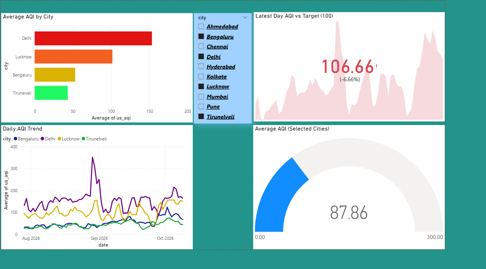

# Air Quality Tracker (India)

Tracks and compares air quality and weather across 10 Indian cities.

## Tech Stack
Python (pandas, requests) | MySQL | Excel | Power BI

## Pipeline
Open-Meteo API → Python (fetch, clean, merge) → MySQL → Power BI
## Database Design

```
Star schema in MySQL: fact_readings (hourly readings) joined to dim_city and dim_date.
```

## Key Findings
1. Delhi had the worst air (avg AQI 164.5, PM2.5 62.6 µg/m³) and Tirunelveli the best (AQI 44.8, PM2.5 9.1), so Delhi's average AQI was about 3.7x Tirunelveli's. Lucknow (104.8) and Kolkata (91.8) ranked 2nd and 3rd.
2. Wind speed had the clearest effect on PM2.5. In all 10 cities, windy hours (10+ km/h) had lower PM2.5 than calm hours (<5 km/h), by about 48% on average (r = -0.49 pooled).
3. Rainy hours had lower PM2.5 than dry hours in 8 of 10 cities, by about 28% on average within cities (up to 52% in Mumbai and Kolkata). Chennai and Tirunelveli, two of the cleanest cities, showed no decrease.
## Dashboard
## Dashboard



## Limitations
- Analysis covers 91 days (21,840 hourly rows across 10 cities), mostly monsoon season, so rain and wind effects are mixed with seasonal change
- Time of day is not controlled for, so part of the wind effect may be the daily cycle
- Associations only, not proof of cause

## How to Run
1. `pip install pandas requests sqlalchemy pymysql`
2. Create a `.env` file with `MYSQL_PASSWORD=your_password` (MySQL must be running; the `air_quality` database is created automatically)
3. `python run_pipeline.py` runs everything: fetch, clean, merge, load to MySQL, build star schema
   - `python run_pipeline.py --skip-fetch` reuses the CSVs in `data/raw`
   - `python run_pipeline.py --skip-db` stops after the merge step
4. Open `powerbi/air_quality_dashboard.pbix` and refresh
